<div align="center">


# Duet

**Floating hands and a digital heart.**
A hybrid analog + digital watch face for Zepp OS.


</div>

---

## Why Duet

Duet pairs two ways of telling time on one dial. Two short, floating hands sweep around the edge, while large digital hours and minutes sit in the center. You read the time at a glance either way — and three small round badges keep your day's data in view.

## Gallery

<table>
  <tr>
    <td align="center">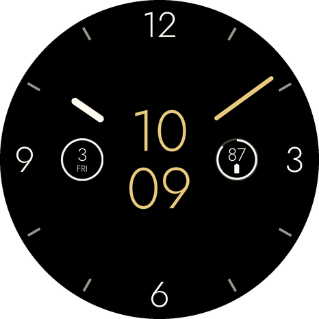<br><sub><b>Champagne</b> (default)</sub></td>
    <td align="center">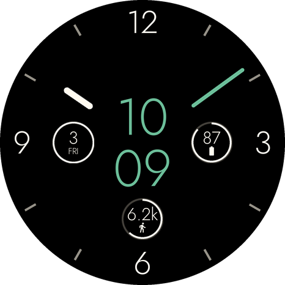<br><sub><b>Emerald</b></sub></td>
    <td align="center">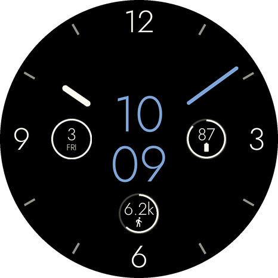<br><sub><b>Sapphire</b></sub></td>
  </tr>
</table>

### Always-On Display

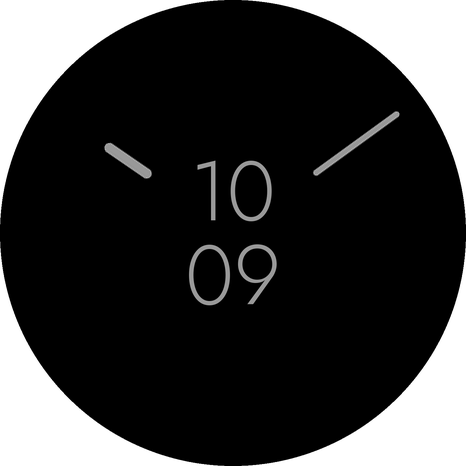

A dimmed, gray version with only the hands and the digits — easy on the battery, still easy to read.

## Features

- **Hybrid time** — analog hands and big digital digits on the same dial
- **8 color themes** — the accent tints the minute hand and the digits
- **3 editable complications** — left, right and bottom badges with progress rings
- **Live weather** — the weather badge shows the current temperature and a condition icon
- **Always-On Display** and **lockscreen** support
- **Everything set on the watch** — long-press the face to edit; no companion app

## Color themes

<table>
  <tr>
    <td align="center">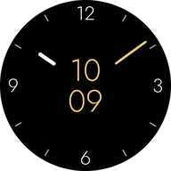<br><sub>Champagne</sub></td>
    <td align="center"><br><sub>Rose Gold</sub></td>
    <td align="center">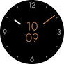<br><sub>Copper</sub></td>
    <td align="center">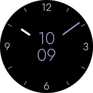<br><sub>Amethyst</sub></td>
  </tr>
  <tr>
    <td align="center">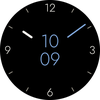<br><sub>Sapphire</sub></td>
    <td align="center">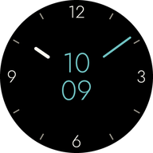<br><sub>Turquoise</sub></td>
    <td align="center">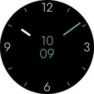<br><sub>Emerald</sub></td>
    <td align="center">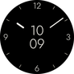<br><sub>Ivory</sub></td>
  </tr>
</table>

## Complications

Each of the three slots (left, right, bottom) can show any of these:

<table>
  <tr>
    <td align="center"><br><sub>Date</sub></td>
    <td align="center">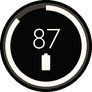<br><sub>Battery</sub></td>
    <td align="center">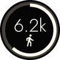<br><sub>Steps</sub></td>
    <td align="center">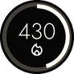<br><sub>Calories</sub></td>
    <td align="center">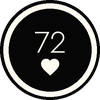<br><sub>Heart rate</sub></td>
    <td align="center">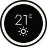<br><sub>Weather</sub></td>
    <td align="center">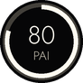<br><sub>PAI</sub></td>
    <td align="center"><br><sub>None</sub></td>
  </tr>
</table>

Defaults: **Date** on the left, **Battery** on the right, **Steps** at the bottom.

## Supported devices

| Device | Screen | Target |
| --- | --- | --- |
| Amazfit Active 2 Round | 466 × 466 | `466x466-amazfit-active-2-round` |
| Amazfit GTR 4 | 466 × 466 | `466x466-amazfit-gtr-4` |

Requires Zepp OS API level 3.0.

## Install

Install **Duet** from the watch face store in the Zepp app.

## Build from source

You need the [Zeus CLI](https://docs.zepp.com/docs/guides/tools/cli/) (`npm i -g @zeppos/zeus-cli`).

```bash
git clone https://github.com/RTeran/duet-watchface.git
cd duet-watchface

zeus dev       # run it in the Zepp OS simulator
zeus preview   # install it on your watch through a QR code in the Zepp app
zeus build     # write the .zab package to dist/
```

### Regenerating the images

The images under `assets/` and `store/` are rendered by Python scripts, not drawn by hand. They need Python 3 with Pillow and fontTools (`pip install pillow fonttools`).

```bash
python3 tools/render-assets.py         # dial, hands, rings and edit-mode previews
python3 tools/render-store-assets.py   # store icon, screenshots and animated GIF
python3 tools/make-icon-font.py        # icon font for the complication badges
```

### Tests

```bash
node --test test/*.mjs
```

## Project structure

```
app.json                 app manifest: targets, permissions, version
watchface/index.js       the watch face: layout, themes, edit groups, data
watchface/weather-icon.js  maps the weather code to an icon glyph
assets/<target>/         per-device images and fonts
tools/                   image and font generators
store/                   store icon, screenshots and GIF (466 px and 360 px)
test/                    unit tests (node:test)
```

## Credits

- [Jost](https://github.com/indestructible-type/Jost) and [Rubik](https://github.com/googlefonts/rubik) — SIL Open Font License 1.1
- [Material Icons](https://github.com/google/material-design-icons) and [Material Symbols](https://github.com/google/material-design-icons) — Apache License 2.0

The license texts ship in the repo: the OFL files in `assets/*/fonts/` and the Apache License in `tools/LICENSE-material-icons.txt`.

## License

The code is released under the [MIT License](LICENSE). Fonts keep their own licenses (see [Credits](#credits)).
